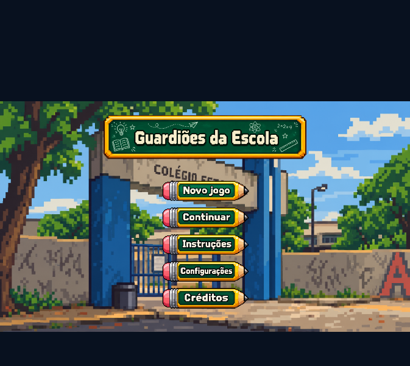
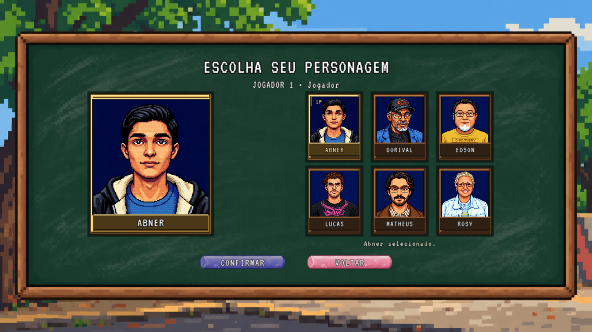
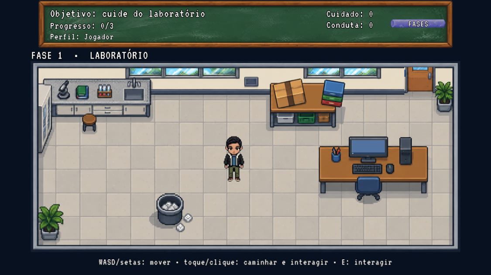
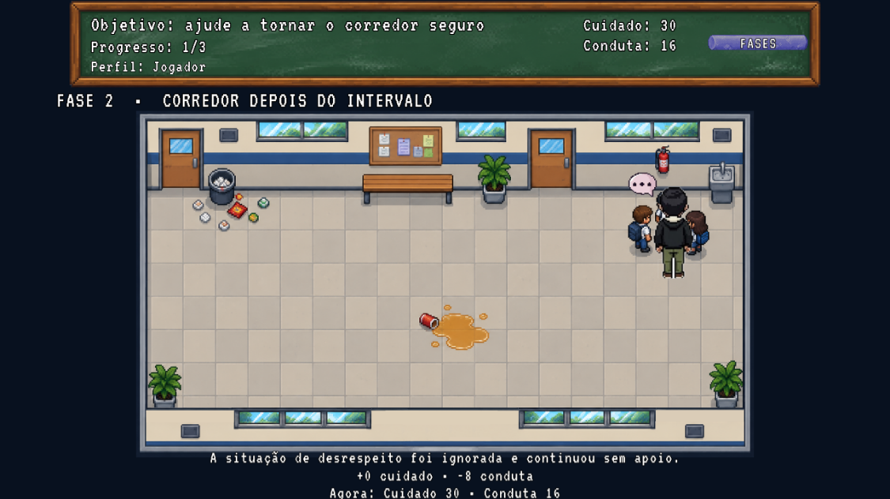
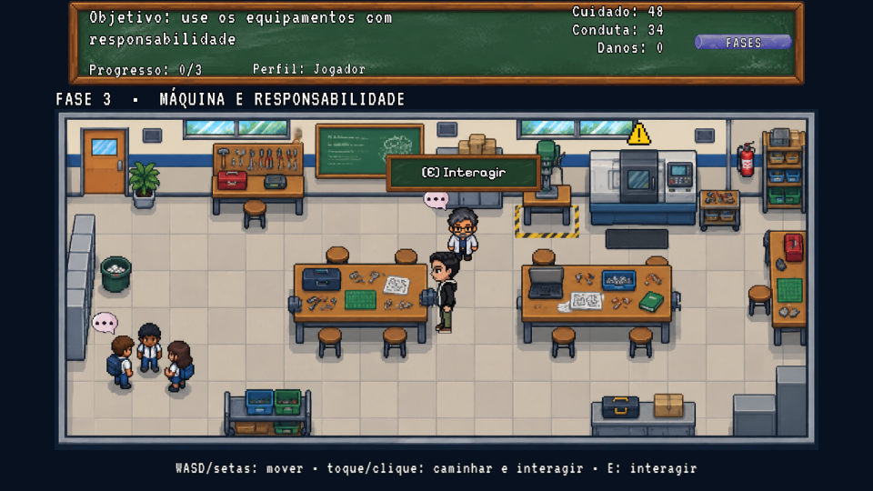

<div align="center">


# Guardiões da Escola

### Pequenas escolhas. Grandes responsabilidades.

**Um jogo educativo em pixel art sobre cidadania, convivência e cuidado com o patrimônio escolar.**

<p>
  <a href="https://matheusbecaridias.github.io/Game/">
    
  </a>
  <a href="#-sobre-o-projeto">
    
  </a>
</p>


</div>

---

## 📌 Sumário

- [Sobre o projeto](#-sobre-o-projeto)
- [Jogue online](#-jogue-online)
- [Visão geral](#-visão-geral)
- [Capturas de tela](#-capturas-de-tela)
- [Gameplay e campanha](#-gameplay-e-campanha)
- [Sistemas e funcionalidades](#-sistemas-e-funcionalidades)
- [Tecnologias](#-tecnologias)
- [Controles](#-controles)
- [Executar localmente](#-executar-localmente)
- [Estrutura do projeto](#-estrutura-do-projeto)
- [Arquitetura](#-arquitetura)
- [Roadmap](#-roadmap)
- [Créditos](#-créditos)
- [Licença](#-Licença)

---

## 🎒 Sobre o projeto

**Guardiões da Escola** é um jogo educativo 2D desenvolvido com JavaScript e Phaser 3. A proposta é transformar situações comuns do ambiente escolar em desafios interativos nos quais o jogador precisa observar, avaliar consequências e tomar decisões responsáveis.

Ao longo da campanha, o jogador explora diferentes espaços da escola e enfrenta situações relacionadas à preservação do patrimônio público, segurança, respeito, cooperação e convivência.

> **O objetivo não é apenas concluir fases:** é perceber como pequenas atitudes individuais podem afetar toda a comunidade escolar.

## 🕹️ Jogue online

<div align="center">

### Experimente a versão publicada

<a href="https://matheusbecaridias.github.io/Game/">
  
</a>

**[https://matheusbecaridias.github.io/Game/](https://matheusbecaridias.github.io/Game/)**

<sub>A publicação online utiliza um repositório separado que contém os arquivos compilados da pasta <code>dist</code>. Este repositório principal é destinado ao código-fonte e ao desenvolvimento completo do projeto.</sub>

</div>

## 🌱 Visão geral

| Informação | Descrição |
|---|---|
| Nome | Guardiões da Escola |
| Tipo | Jogo educativo |
| Gênero / perspectiva | Aventura 2D, visão top-down com perspectiva suave |
| Estilo visual | Pixel art |
| Proposta | Cidadania escolar, escolhas e responsabilidade coletiva |
| Engine | Phaser 3 |
| Plataforma de execução | Navegadores compatíveis com HTML5 |
| Estado | Em desenvolvimento — MVP/protótipo |

## 🖼️ Capturas de tela

<div align="center">



<sub>Tela inicial — menu principal do jogo.</sub>

</div>

<div align="center">



<sub>Tela de seleção de personagens.</sub>

</div>

<div align="center">



<sub>Tela da fase 1 - Laboratório.</sub>

</div>

<div align="center">



<sub>Tela da fase 2 - Corredor.</sub>

</div>

<div align="center">



<sub>Tela da fase 3 - Laboratório 2.</sub>

</div>


## 🎮 Gameplay e campanha

A campanha identificada no projeto é composta por três fases:

### 1. Laboratório

O jogador encontra situações que exigem cuidado com o espaço e os equipamentos: lixo fora da lixeira, computadores ligados sem necessidade e materiais guardados incorretamente.

### 2. Corredor depois do intervalo

Os desafios envolvem resíduos no chão, líquido derramado e situações de desrespeito entre colegas. As decisões convidam à prevenção de acidentes e à convivência respeitosa.

### 3. Máquina e responsabilidade

A fase aborda o uso responsável de máquinas e equipamentos, a recusa de propostas arriscadas e o respeito às orientações do professor ou laboratorista.

### 📊 Escolhas, pontuação e finais

As decisões afetam três indicadores:

- **Cuidado:** atenção à conservação, à organização e à higiene dos espaços.
- **Conduta:** respeito às regras, às pessoas e à convivência coletiva.
- **Danos:** registro de avarias causadas a equipamentos ou ao patrimônio.

Ao final da campanha, a combinação dos resultados determina um dos desfechos:

| Desfecho | Significado |
|---|---|
| **Guardião da Escola** | Resultado associado a cuidado elevado e conduta responsável. |
| **Aprendeu e Reparou** | O jogador reconhece erros e realiza ações de reparação. |
| **Responsabilização** | Resultado associado a danos ou descumprimento de orientações de segurança. |

## ✨ Sistemas e funcionalidades

### Implementados na versão analisada

- [x] Menu principal, instruções, configurações e créditos.
- [x] Criação e gerenciamento de múltiplos perfis locais.
- [x] Seleção entre seis personagens jogáveis.
- [x] Três fases da campanha.
- [x] Movimentação por teclado.
- [x] Navegação por clique ou toque, com busca de caminho.
- [x] Pathfinding A* com estrutura MinHeap.
- [x] Interações e escolhas contextualizadas.
- [x] Indicadores de Cuidado, Conduta e Danos.
- [x] Progressão entre fases e cálculo de três finais.
- [x] Persistência local de perfis e progresso via `localStorage`.
- [x] Cenários que reagem a determinadas ações.
- [x] HUD com objetivo e progresso da fase.
- [x] Música e efeitos sonoros com Web Audio API e fallback procedural.
- [x] Adaptação de controles para telas móveis, incluindo remapeamento de toque em orientação retrato.

### Itens identificados como planejados

- [ ] Exportação e importação de saves em JSON.
- [ ] Suporte completo a controles gamepad USB/Bluetooth.
- [ ] Ampliação dos efeitos sonoros com gravações de voz e passos.
- [ ] Trilha sonora específica para cada fase.
- [ ] Melhorias de acessibilidade, incluindo recursos descritivos para áudio.
- [ ] Opções adicionais de apresentação e contraste.

> A lista representa o estado descrito na documentação analisada e deve ser revisada quando o código evoluir.

## 🧰 Tecnologias

| Tecnologia | Utilização |
|---|---|
| [JavaScript (ES Modules)](https://developer.mozilla.org/docs/Web/JavaScript) | Lógica e organização do código |
| [Phaser 3](https://phaser.io/) | Engine de jogos 2D |
| [Vite](https://vite.dev/) | Servidor de desenvolvimento e build |
| HTML5 Canvas | Renderização do jogo |
| Phaser Arcade Physics | Física e colisões |
| Web Audio API | Reprodução e síntese de áudio |
| `localStorage` | Persistência local dos perfis e progresso |

**Configuração gráfica identificada:** resolução lógica de 1280 × 720, proporção 16:9 e escala adaptativa `FIT`.

## 🎹 Controles

| Ação | Teclado | Mouse / toque |
|---|---|---|
| Movimentar | `W`, `A`, `S`, `D` ou setas | Clique ou toque no chão para traçar uma rota |
| Interagir | `E`, próximo ao objeto | Clique ou toque no objeto |
| Cancelar / voltar | `Esc` | Clique fora da caixa de diálogo, quando aplicável |
| Navegar nos menus | Setas e `Enter` | Toque nos botões |
| Tela cheia | `F11` (quando suportado pelo navegador) | Recurso do navegador/dispositivo |

Os comandos podem variar conforme a tela e o contexto da interação.

## 💻 Executar localmente

### Requisitos

- [Node.js](https://nodejs.org/) 18 ou superior.
- npm.
- Navegador moderno compatível com HTML5.

### 1. Clone o repositório

```bash
git clone https://github.com/matheusbecaridias/Guardioes-da-Escola.git
cd guardioes-da-escola
```

> Substitua `URL_DO_REPOSITORIO_PRINCIPAL` pelo endereço deste repositório de código-fonte. O endereço de jogo online informado neste README é a publicação da versão compilada, não o clone do projeto-fonte.

### 2. Instale as dependências

```bash
npm install
```

### 3. Inicie o servidor de desenvolvimento

```bash
npm run dev
```

O Vite exibirá no terminal o endereço local para abrir no navegador (normalmente `http://localhost:5173`).

### 4. Gere a versão de produção

```bash
npm run build
```

Os arquivos compilados serão gerados no diretório `dist/`.

### 5. Teste a versão compilada localmente

```bash
npm run preview
```

O comando `preview` utiliza o script padrão do Vite, caso esteja definido no `package.json`.

## 🗂️ Estrutura do projeto

A estrutura abaixo resume os diretórios e módulos identificados no projeto:

```text
guardioes-da-escola/
├── public/
│   └── assets/
│       ├── audio/          # Músicas e sons
│       ├── fonts/          # Tipografia
│       └── images/         # Sprites, cenários e elementos visuais.
├── src/
│   ├── data/               # Dados, configurações e perfis
│   ├── entities/           # Entidades do jogo e movimentação
│   ├── scenes/             # Menus, fases e telas
│   ├── services/           # Regras, navegação, progresso e áudio
│   ├── ui/                 # HUD, botões e diálogos
│   └── main.js             # Inicialização do Phaser
├── docs/
│   └── images/             # Imagens da documentação
├── index.html
├── package.json
├── vite.config.js
└── README.md
```

A árvore é resumida para facilitar a leitura. Consulte os diretórios do repositório para a relação completa de arquivos.

## 🏗️ Arquitetura

O projeto separa, em linhas gerais, cenas, entidades, interface, dados e serviços:

- **`scenes/`:** controla menus, fases, seleção de personagens, resultados e encerramento.
- **`entities/`:** concentra entidades de gameplay, como o jogador e sua movimentação.
- **`services/`:** reúne regras de escolhas, progressão, finais, navegação e áudio.
- **`data/`:** mantém configurações, dados dos personagens, fases, colisões e perfis.
- **`ui/`:** implementa elementos visuais reutilizáveis, diálogos, botões e HUD.

### Fluxo simplificado

```text
Perfil do jogador
       │
       ▼
Escolhas e interações
       │
       ▼
ChoiceService ───────► Métricas
       │                  │
       ▼                  ▼
ProgressionService   ProfileRepository
       │                  │
       ▼                  ▼
     Fases             localStorage
       │
       ▼
  EndingService
       │
       ▼
  Desfecho final
```

## 🧭 Roadmap

O projeto permanece em desenvolvimento. As prioridades abaixo organizam os itens que foram identificados como próximos passos, sem estabelecer datas de entrega.

- [ ] Modularizar cenários em camadas independentes, reduzindo a dependência de imagens completas para cada estado.
- [ ] Desenvolver trilhas sonoras específicas para os ambientes.
- [ ] Implementar exportação e importação de progresso.
- [ ] Ampliar suporte a gamepads.
- [ ] Aprimorar acessibilidade e recursos de apresentação.
- [ ] Revisar e testar a experiência em diferentes navegadores e dispositivos.

## 🎓 Créditos

O projeto é identificado como um trabalho de caráter acadêmico.

- **Projeto:** Guardiões da Escola.
- **Equipe:** equipe acadêmica do projeto:
  - **[ABNER](https://github.com/wicz-ui)** - Front-End,
  - **[DORIVAL](https://github.com/silvajuniordorival-eng)** - Banco de Dados,
  - **[EDSON](https://github.com/EdysPsy)** - Product Owner,
  - **[LUCAS]()** - Cliente,
  - **[MATHEUS](https://github.com/matheusbecaridias)** - Scrum Master,
  - **[ROSY LOIRA](https://github.com/souzarosimari-jpg)** - Back-End.
- **Instituição:**  CEEP Professora Maria do Rosário Castaldi.


## 📄 Licença

[Licença](LICENSE)

<div align="center">

**Guardiões da Escola**

*Aprender a cuidar também faz parte da jornada.*

<a href="https://matheusbecaridias.github.io/Game/">
  
</a>

</div>
